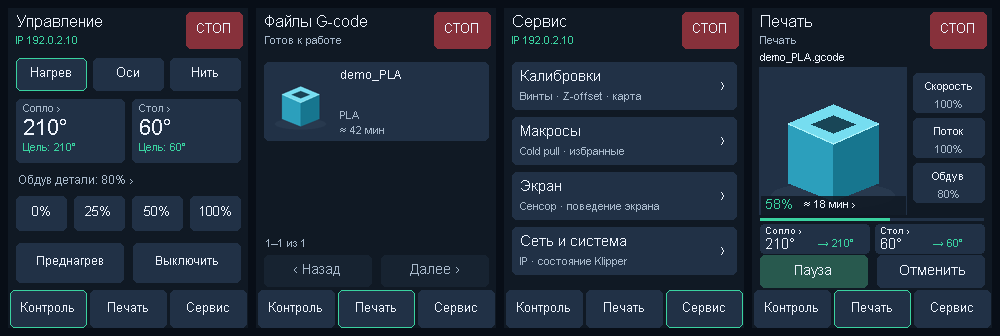
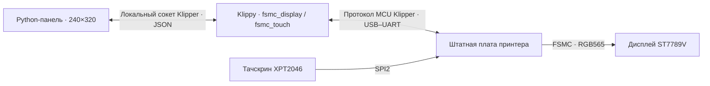

# Kingroon TFT24 for Klipper

Штатный вертикальный сенсорный экран Kingroon KP3S Pro S1 снова работает после перехода на Klipper. Экран остаётся подключён штатным шлейфом к материнской плате, а Linux-хост общается с ней через существующий USB–UART.

Автор проекта собрал и доработал решение из нескольких открытых проектов. За основу драйвера взята работа Aregus393 для штатного экрана Flying Bear Ghost 5. Под Kingroon адаптированы инициализация, распиновка, сенсор, передача изображения и меню. Авторы исходного кода и механики перечислены в [источниках](SOURCES.md).

*Klipper support for the stock portrait 240×320 touchscreen on a Kingroon KP3S Pro S1. Includes STM32 MCU firmware additions, Klipper modules and a standalone Python panel.*



## Что доступно с экрана

- **Управление** — IP-адрес, текущие и целевые температуры, нагрев, обдув, перемещение XYZ и подача филамента.
- **Файлы** — G-code с диска Linux-хоста, миниатюры из слайсера, запуск с подтверждением.
- **Сервис** — избранные макросы, карта стола, регулировка винтов и Z-offset. Набор команд зависит от настроек Klipper.
- **Во время печати** — отдельный экран с миниатюрой, прогрессом, оценкой оставшегося времени и быстрым доступом к температуре, скорости, потоку, обдуву и управлению заданием.

## Как это работает



Панель рисует интерфейс на хосте и отправляет изменившиеся прямоугольники через API `fsmc_display/draw_rle`. Модуль Klippy передаёт их по протоколу Klipper как команды MCU, и драйвер выводит пиксели через параллельную шину FSMC. Касания панель читает через `fsmc_touch/read`. Для работы панели достаточно локального сокета Klipper и собственной прошивки MCU.

## Совместимость

На принтере проекта проверены штатная плата с конфигурацией сборки `stm32f103xe`, вертикальный ST7789V (ID `0x8552`), XPT2046 и USB–UART через USART3. Проверены работа изображения и сенсора на 250 000 бод и ускоренный режим 1 000 000 бод. Профиль ILI9341 есть в коде и требует отдельной проверки на оборудовании. Для других ревизий сначала сверьте распиновку, контроллер дисплея, загрузчик и параметры связи.

- [Установка, проверка и откат](docs/install.md)
- [Исходники, зависимости и ссылки на авторов](SOURCES.md)
- [Доработки принтера и печатные детали](docs/hardware.md)

## Проверка без принтера

```sh
python3 -m pip install -r requirements-test.txt
python3 -m unittest discover -s tests -v
python3 panel.py --preview preview.png
```

На Linux для отрисовки нужен пакет `fonts-dejavu-core`. На Windows отрисовка использует системный Arial, если DejaVu Sans недоступен.

Код распространяется под [GNU GPL v3](LICENSE). Авторские уведомления и сведения об исходных проектах сохранены.
